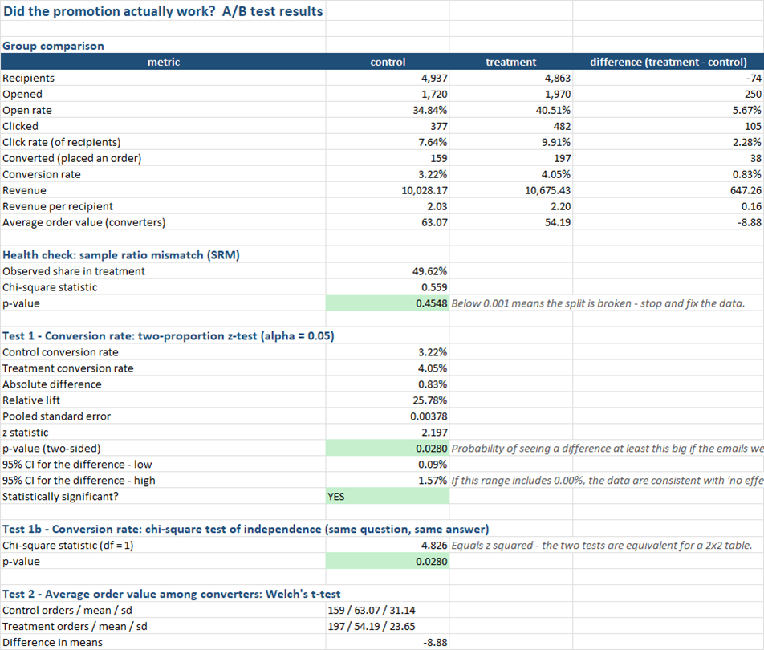
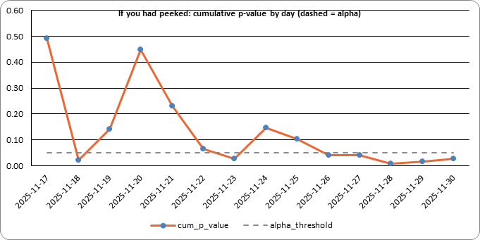
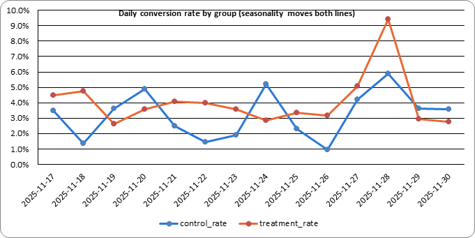

# Did that promotion actually work? A/B testing for small businesses

A small pipeline that generates a fake email-campaign A/B test, validates it, and runs
the standard statistical checks on it — writing the input data, the test results, a
"how big should the next test be" calculator and a pitfalls checklist into a single
Excel workbook.

**Why SMEs care:** Black Friday emails, discount codes and layout changes get judged on
"sales went up". Nobody checks whether the difference is noise, whether the discount
quietly shrank baskets, or whether the test was even big enough to see the effect it
claims. This repo shows what checking looks like, with no statistics software required.

The methods are the textbook ones:

- **Two-proportion z-test** — did conversion rate really differ between control and treatment?
  `z = (p2 - p1) / sqrt(pbar (1 - pbar) (1/n1 + 1/n2))`, two-sided p-value, plus a 95%
  confidence interval for the difference.
- **Chi-square test (2x2)** — the same question asked a different way; the statistic
  equals `z²` exactly, and the workbook shows both so the equivalence is visible.
- **Welch's t-test** — did average order value (basket) differ among buyers, and did
  *revenue per recipient* (the metric that pays the bills) differ across everyone?
- **Minimum sample size** — recipients per group needed to detect a given lift at a given
  significance level and power; and **how long to run** the next test at your send volume.
- **Achieved power / minimum detectable effect** — what the test you *already* ran could see.
- **Sample ratio mismatch** — a health check that the 50/50 split actually landed 50/50.
- **Common pitfalls** — peeking, seasonality, novelty, slicing, wrong metric, and more, each
  illustrated by the demo data.

## How it works

Three scripts, run in order, each consuming the previous one's output:

1. **`generate_data.py`** — uses [Faker](https://faker.readthedocs.io/) to create a fake
   list of campaign recipients (customer, group, segment, send date, opened / clicked /
   converted, order value) and writes it to `data/campaign_raw.csv`. The simulated
   campaign goes out in daily batches over two weeks around Black Friday. The treatment
   email (with a discount code) converts better but has a *smaller average basket*, there
   is weekday / Black Friday seasonality that hits both groups equally, and a decaying
   novelty boost makes the treatment look best in its first days. A small percentage of
   rows are deliberately corrupted (invalid group labels, clicks without opens, orders
   without conversions, negative order values, a duplicate customer) so the next step has
   real errors to catch.
2. **`validate_data.py`** — checks every row in `data/campaign_raw.csv` against the schema
   in `ab_common.py` (via [pydantic](https://docs.pydantic.dev/)), including funnel
   consistency rules, drops invalid or duplicate rows, and writes:
   - `data/campaign_validated.csv` — the clean rows
   - `data/validation_report.txt` — what was rejected and why
3. **`analyze_ab_test.py`** — reads `data/campaign_validated.csv`, runs every test, and
   writes a new `output/ab_test_analysis.xlsx` workbook with six sheets:
   - **Results** — group comparison (open rate, click rate, conversion, revenue, revenue
     per recipient, average order value), the sample-ratio health check, each test with
     its statistic, p-value and confidence interval (green = significant, amber = not),
     the power of the test you ran, and a plain-English verdict
   - **Input Data** — the validated records the analysis ran on
   - **Daily Breakdown** — per-day funnel per group, the *cumulative* p-value you would
     have seen if you had peeked each day, and two charts: the wandering p-value against
     the alpha line, and daily conversion by group showing seasonality moving both lines
   - **Segments** — the same z-test per customer segment, with the Bonferroni-corrected
     threshold shown alongside so slicing does not manufacture a result
   - **Sample Size Calculator** — a live Excel calculator (edit the yellow cells: baseline
     rate, lift to detect, alpha, power, daily send volume, split) that returns recipients
     per group, total, and days / weeks to run; a pre-computed table across lift sizes; and
     a bonus calculator for testing basket value instead of conversion
   - **Pitfalls** — the checklist of ways this kind of analysis goes wrong

`ab_common.py` holds the shared data model and file paths used by all three scripts.
`ab_stats.py` holds the statistics (z-test, chi-square, Welch t, power, sample size) in
plain Python so the formulas are easy to read and reuse; `test_ab_stats.py` checks them
against textbook values.

> **Example Results** : [sample_results.xlsx](./sample_results.xlsx)


With the default seed the demo tells the classic SME story: conversion is up 26% and
*statistically significant* (p = 0.028), but the discount cut the average basket by 14%,
so revenue per recipient is only up 8% and *not* distinguishable from noise. The daily
sheet shows the cumulative p-value dipping under 0.05 on day 2, bouncing back to 0.45 by
day 4, and crossing again several times — exactly why you decide the sample size first
and look once.




## Setup

### 1. Get the code

```powershell
git clone <your-repo-url>
cd ab-testing-for-smes
```

### 2. Create and activate a virtual environment

**Windows (PowerShell):**

```powershell
python -m venv .venv
.venv\Scripts\Activate.ps1
```

**macOS / Linux:**

```bash
python3 -m venv .venv
source .venv/bin/activate
```

### 3. Install dependencies

```powershell
pip install -r requirements.txt
```

Requires Python 3.10+ (uses `statistics.NormalDist`, `math.lgamma` and PEP 604 type
hints — no `scipy` or `numpy` needed; Student's t is implemented with an incomplete-beta
continued fraction in `ab_stats.py`).

## Usage

Run the three scripts in order from the project root, with the virtual environment
activated:

```powershell
python generate_data.py --count 10000 --error-rate 0.02 --seed 42
python validate_data.py
python analyze_ab_test.py
```

Then open `output/ab_test_analysis.xlsx`. The analysis also prints a one-screen summary:

```
Analyzed 9800 recipients (4937 control / 4863 treatment) -> output/ab_test_analysis.xlsx
Conversion: 3.22% -> 4.05% (+25.8%), p = 0.0280, 95% CI [+0.09%, +1.57%] -> SIGNIFICANT
Revenue/recipient: 2.031 -> 2.195 (+8.1%), p = 0.5014 -> not significant
Next test: to detect a 15% relative lift you need 22,481 per group (~65 days at 700 recipients/day).
Peeking: the cumulative p-value was below 0.05 on 7 of 14 days.
```

To run the unit tests for the statistics module:

```powershell
python -m unittest test_ab_stats.py
```

### Options

| Script | Flag | Default | Description |
| --- | --- | --- | --- |
| `generate_data.py` | `--count` | `10000` | Number of recipients to generate |
| | `--error-rate` | `0.02` | Fraction of rows to deliberately corrupt (`0` for a perfectly clean dataset) |
| | `--seed` | none | Random seed, for reproducible output |
| | `--output` | `data/campaign_raw.csv` | Where to write the raw data |
| | `--control-rate` | `0.03` | True conversion rate of the control email |
| | `--treatment-rate` | `0.039` | True conversion rate of the treatment email (set equal to the control rate to simulate a promotion that does nothing) |
| | `--control-basket` | `62` | Mean order value in the control group |
| | `--treatment-basket` | `55` | Mean order value in the treatment group |
| | `--days` | `14` | Number of daily send batches |
| | `--treatment-share` | `0.5` | Probability a recipient lands in the treatment group |
| | `--novelty` | `0.6` | Size of the decaying first-days treatment boost (`0` disables it) |
| | `--start-date` | `2025-11-17` | First send date |
| `validate_data.py` | `--input` | `data/campaign_raw.csv` | File to validate |
| | `--output` | `data/campaign_validated.csv` | Where to write the cleaned data |
| | `--report` | `data/validation_report.txt` | Where to write the rejection report |
| `analyze_ab_test.py` | `--input` | `data/campaign_validated.csv` | File to analyze |
| | `--output` | `output/ab_test_analysis.xlsx` | Where to write the results workbook |
| | `--alpha` | `0.05` | Significance level used by every test |
| | `--power` | `0.8` | Target power for the sample-size planning |
| | `--mde-rel` | `0.15` | Relative lift the *next* test should be able to detect (pre-fills the calculator) |
| | `--daily-recipients` | observed average | Recipients you can email per day, for the "how long to run" estimate |
| | `--treatment-share` | `0.5` | Planned split, for the sample-ratio-mismatch check |

Every script can also point at a custom input/output path, so you can drop in your own
real campaign export (matching the columns in `ab_common.py`: one row per recipient with
`group` = `control` or `treatment`, `segment` = `new` or `returning`, a `send_date`, the
`opened` / `clicked` / `converted` flags and the `order_value`) and run it straight through
`validate_data.py` and `analyze_ab_test.py`, skipping `generate_data.py`.

Useful experiments with the fake data:

- `--treatment-rate 0.03` — a promotion with **no real effect**. Re-run a few seeds and
  watch how often a day's cumulative p-value still dips under 0.05 (the peeking problem).
- `--count 2000` — a small list. The observed lift may be large, but the confidence
  interval will straddle zero and the *minimum detectable lift* will be enormous.
- `--novelty 2 --days 21` — a strong novelty effect; compare the first-week and
  third-week rows on the Daily Breakdown sheet.
- `--treatment-share 0.45` — a broken randomiser; the sample-ratio check should fire.

## Project layout

```
ab-testing-for-smes/
├── ab_common.py            # shared schema + file paths
├── ab_stats.py             # z-test, chi-square, Welch t, power, sample size (pure Python)
├── test_ab_stats.py        # unit tests for ab_stats.py
├── generate_data.py        # step 1: fake campaign data generation
├── validate_data.py        # step 2: schema validation / cleaning
├── analyze_ab_test.py      # step 3: tests, CIs, peeking, segments, calculator -> Excel
├── requirements.txt
├── data/                    # generated CSVs + validation report (not committed)
└── output/                  # generated Excel workbook (committed)
```

`data/` is gitignored (apart from a `.gitkeep` placeholder) since its
contents are reproducible by re-running the scripts — as is `.venv/`, so the virtual
environment itself is never pushed to the repo.


> **Disclaimer** — This software is provided for educational and demonstration purposes only. See the full [Disclaimer & EULA](./DISCLAIMER.md) for details.
